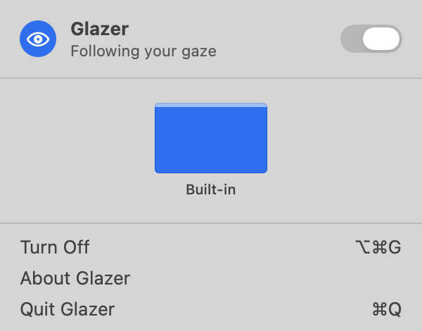

# Glazer

**Your keyboard follows your eyes.** Glazer is a small macOS menu bar app for people who
work across a MacBook and an external display. Look at the other screen and start typing:
Glazer moves the pointer and keyboard focus there for you.

<p align="center">
  <picture>
    <source media="(prefers-color-scheme: dark)" srcset="docs/images/panel-dark.png">
    
  </picture>
</p>

> [!NOTE]
> Glazer is in early development. The menu bar app works today. Following your gaze is
> being built; see the [roadmap](#roadmap).

## How it works

Glazer doesn't try to work out the exact spot you're looking at, which webcams can't do
reliably. It asks a much easier question: **which display is your head facing?**

1. The camera sees your face, and Apple's Vision framework measures which way your head
   is turned.
2. A short calibration records the angle for each of your displays.
3. When you face another display for about half a second, Glazer moves the pointer there
   and brings back the window you were last using on it.

If other people are in view, Glazer follows only the person at the Mac: the nearest face,
locked on from frame to frame. When it isn't sure, it does nothing.

Everything happens on your Mac. Glazer never records, saves or sends video, and makes no
network requests. See [Privacy](docs/PRIVACY.md).

## Install

Glazer needs macOS 14 Sonoma or later.

Signed releases are coming with version 0.1. Until then, build it from source:

```sh
git clone https://github.com/phanipaladugula/glazer.git
cd glazer
Scripts/bundle.sh --open
```

This builds `dist/Glazer.app` and opens it. You only need Apple's Command Line Tools
(`xcode-select --install`), not Xcode. Copy the app to `/Applications` to keep it.

## Use

- **Click the eye** in the menu bar to open the panel.
- **Turn Glazer on or off** with the switch, or press **⌥⌘G** from any app. When Glazer
  is off, the camera is off.

## Roadmap

- [x] Menu bar app with on/off switch, display map and global shortcut
- [ ] Head direction from the camera, following only the person at the Mac
- [ ] Calibration
- [ ] Move pointer and keyboard focus to the display you face
- [ ] Settings, launch at login, signed release

## Contributing

Bug reports, ideas and pull requests are welcome. Start with
[CONTRIBUTING.md](CONTRIBUTING.md), and read [ARCHITECTURE.md](docs/ARCHITECTURE.md) for
how the code fits together.

## License

[MIT](LICENSE)
