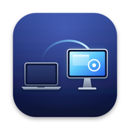
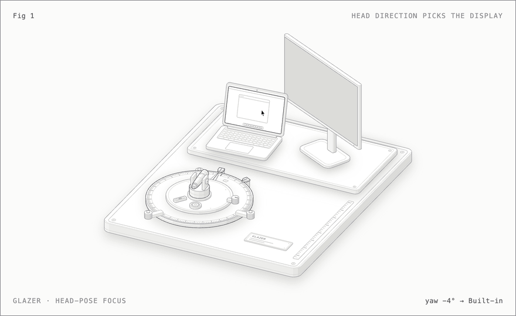
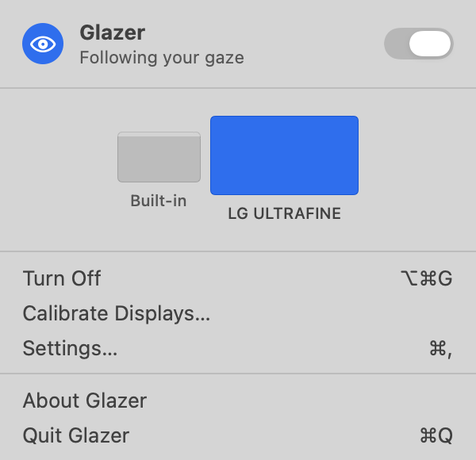
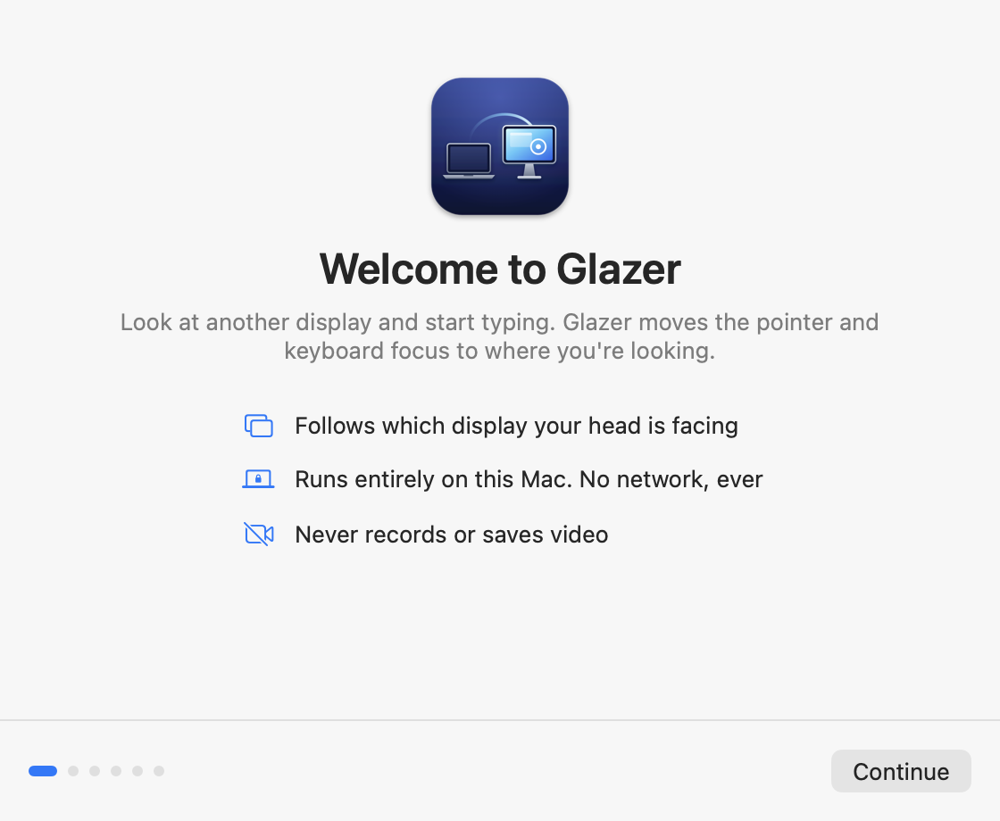
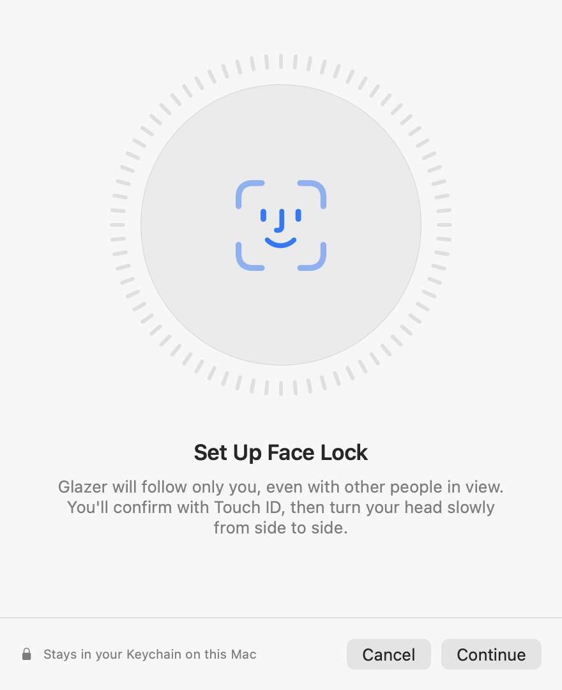

<div align="center">



# Glazer

**Your keyboard follows your eyes.**

A macOS menu bar app for people who work across a MacBook and an external display.
Look at the other screen and start typing. Glazer moves the pointer and keyboard focus there for you.

[](https://github.com/phanipaladugula/glazer/actions/workflows/ci.yml)


[](LICENSE)

<picture>
  <source media="(prefers-color-scheme: dark)" srcset="docs/images/hero-dark.gif">
  
</picture>

</div>

## Contents

- [Why Glazer](#why-glazer)
- [How it works](#how-it-works)
- [Privacy](#privacy)
- [Install](#install)
- [Getting started](#getting-started)
- [Switch with a key](#switch-with-a-key)
- [Face lock](#face-lock)
- [Troubleshooting](#troubleshooting)
- [Roadmap](#roadmap)
- [Contributing](#contributing)

## Why Glazer

With two displays, typing on the other screen means finding the pointer, dragging it
across and clicking into the right window, dozens of times a day. Glazer removes that
step. Turn to the other display and keep typing.

- **Hands-free focus switching.** The pointer and keyboard focus go to the window you were last using on the display you face.
- **Or switch with a key.** Prefer no camera? Double-press **fn** (or a right-hand modifier) to jump to the next display. Use it alone, or alongside the camera.
- **Follows only you.** It ignores people walking past or sitting behind you. With face lock on, it follows only your face.
- **Ignores glances.** A switch happens only after you've faced the other display for a moment, and looking down at your phone changes nothing.
- **Never switches while you type.** Keep typing while you look at notes or talk to someone, and your words stay put. Pause for a second while facing the other display, and it's ready for you.
- **Private by design.** Everything runs on your Mac. No video is recorded and nothing goes over the network.
- **Native and light.** A small menu bar app built with Apple frameworks only, using about 12 camera frames a second, and the camera stays off when it isn't needed.

<p align="center">
  <picture>
    <source media="(prefers-color-scheme: dark)" srcset="docs/images/screenshots/panel-dark.png">
    
  </picture>
</p>

## How it works

Webcams can't reliably tell the exact spot you're looking at. Glazer answers an easier
question that's enough to pick a display: **which display is your head facing?**

1. **Measure.** The camera sees your face, and Apple's Vision framework measures which way your head is turned (yaw and pitch).
2. **Calibrate.** You look at and click a dot at the centre and each corner of every display, and Glazer records where your head points for each, so it knows where one display ends and the next begins.
3. **Decide.** When you face another display, clearly and for half a second, Glazer moves the pointer there and brings back the window you last used on it.

Glazer pauses rather than guesses. If the room is too dark, no one is in view, or (with face
lock) the person isn't you, nothing moves. The [architecture guide](docs/ARCHITECTURE.md)
explains the full pipeline.

## Privacy

Glazer uses your camera, so it holds itself to a strict standard:

| | |
|---|---|
| **On your Mac only** | Frames are analysed with Apple's Vision framework and discarded immediately. Glazer makes no network requests at all. |
| **No recordings** | No video, photos or screenshots are ever saved. Window titles and screen contents are never read. |
| **Camera off when idle** | The camera runs only while Glazer is on, set to follow where you look, and you have two displays. Switching by key never turns it on. The camera light always tells you. |
| **Face lock in the Keychain** | Your face signature is a list of numbers, not a photo. It's kept in your login keychain and never synced to iCloud, and setting it up or deleting it in Glazer needs Touch ID. |

Read the full [privacy statement](docs/PRIVACY.md). Glazer is open source and has no
third-party dependencies, so every claim can be checked in the code.

## Install

**Requirements:** macOS 15 Sequoia or later on Apple silicon or Intel, a camera, and two displays.

Paste this into Terminal:

```sh
curl -fsSL https://raw.githubusercontent.com/phanipaladugula/glazer/main/install.sh | bash
```

The [install script](install.sh) downloads the latest release, checks its SHA-256 checksum
and code signature, installs Glazer into Applications and opens it. It doesn't use `sudo`
and installs nothing else.

<details>
<summary><b>Other ways to install</b></summary>

**Read the script first.** Download it, read it, then run it:

```sh
curl -fsSLO https://raw.githubusercontent.com/phanipaladugula/glazer/main/install.sh
less install.sh
bash install.sh
```

**A specific version:** `bash install.sh --version 0.1.0`

**Download manually.** Get `Glazer.zip` from the [latest release](https://github.com/phanipaladugula/glazer/releases/latest),
unzip it and move Glazer to Applications. Releases are signed ad hoc, not with an Apple
Developer ID, so the first time, right-click Glazer and choose **Open**.

**Build from source.** You need only Apple's Command Line Tools (`xcode-select --install`):

```sh
git clone https://github.com/phanipaladugula/glazer.git
cd glazer
Scripts/bundle.sh --open
```
</details>

**Update** by running the install command again. **Uninstall** with:

```sh
curl -fsSL https://raw.githubusercontent.com/phanipaladugula/glazer/main/install.sh | bash -s -- --uninstall
```

## Getting started



The first time Glazer opens, a short setup walks you through:

1. **How to switch.** Where you look, double-pressing a key, or both.
2. **Camera.** Allow access so Glazer can see which way you're facing. *(Skipped when you switch by key only.)*
3. **Accessibility.** Allow it so Glazer can bring the right window to the front, and hear your double-press in any app.
4. **Calibration.** Look at and click the dot at the centre and corners of each display, about half a minute in all.
5. **Face lock** *(optional).* Glazer learns your face, so it follows only you.

After that, Glazer lives in the menu bar.

| Action | How |
|---|---|
| Turn Glazer on or off | Click the eye in the menu bar, or press **⌥⌘G** anywhere |
| Jump to the next display | Double-press **fn** (when switching by key is on) |
| Choose camera, key or both | **Settings › General › Switch displays by** |
| Recalibrate after moving a display | Menu bar › **Calibrate Displays…** |
| Change how quickly it switches | **Settings › General › Switch after** |
| See what Glazer sees | **Settings › Diagnostics** (live numbers, never images) |

<br clear="right">

## Switch with a key

Not every moment suits a camera: a dark room, a video call, or simply preferring not to
use one. In **Settings › General**, choose to switch displays by:

- **Where I look:** the camera follows which display you face.
- **Double-pressing a key:** each double-press moves the pointer and keyboard to the next display, top to bottom, then left to right. The camera stays off.
- **Both:** Glazer follows where you look, and a double-press jumps straight away. The key keeps working if the camera can't see you.

The key is **fn / 🌐** by default, or right ⌥ Option, right ⌘ Command, right ⌃ Control or
right ⇧ Shift. Pressing the key with any other key, or holding it, never counts. Glazer
sees only which modifier keys go up and down, never what you type. If macOS Dictation is
set to start on a double-press of fn, pick another key.

## Face lock



> [!NOTE]
> Face lock is **experimental**. Apple doesn't offer face recognition to apps, so it uses a
> general image comparison built into macOS. In testing it told people apart, but with a
> small margin. Glazer works well without it.

Without face lock, Glazer follows the person nearest the camera and holds on to them as
others come and go. With face lock, it follows only you.

- **Setup** takes about ten seconds: confirm with Touch ID, then turn your head slowly from side to side.
- **What's stored** is a face signature, a list of numbers computed by Apple's Vision framework. It's kept in your login Keychain and never leaves your Mac.
- **Delete it** at any time in **Settings › Face Lock**. That needs Touch ID too.

Face lock tells you apart from other people in view. It is **not** a security feature like
Touch ID: someone who looks very like you may be recognised as you. [ADR 0004](docs/adr/0004-face-lock-with-vision-feature-prints.md)
explains the approach and its limits.

<br clear="right">

## Troubleshooting

<details>
<summary><b>Check that the camera sees your head turn</b></summary>

From a clone of the repository, run:

```sh
swift run glazer-camera-check
```

It prints your head's yaw live, using Glazer's own camera code. Turning from one display
to the other should change it smoothly by 20° or more. Nothing is recorded.
</details>

<details>
<summary><b>It picks the wrong display</b></summary>

Recalibrate from the menu bar. Turn your **head** towards each dot while calibrating,
not just your eyes. Calibrations from Glazer 0.1 recorded only the centre of each display;
calibrating again adds the corners, which helps most near the edge between displays. If
your displays sit very close together, try angling them apart a little.
</details>

<details>
<summary><b>It says "Too dark to see you"</b></summary>

Mac cameras can't see in the dark, and there's no infrared camera on a Mac. Light from your
screens is usually enough. If not, a small lamp in front of you fixes it. Glazer pauses in
the dark rather than guessing, so it never moves your pointer by mistake.
</details>

<details>
<summary><b>The pointer moves, but the window doesn't come to the front</b></summary>

Allow Glazer in **System Settings › Privacy & Security › Accessibility**. Without it, macOS
may decline to bring another app's window forward.
</details>

<details>
<summary><b>I turned to talk to someone, and focus moved</b></summary>

If you weren't typing, Glazer takes facing the other display as wanting to work there.
Nothing is typed into it, and focus comes back when you face your display again. While
you're typing, Glazer never switches.
</details>

<details>
<summary><b>Glazer switches when I only glance at the other display</b></summary>

Raise **Settings › General › Switch after**. At 1 second or more, only a deliberate look
switches.
</details>

<details>
<summary><b>macOS asks to let Glazer use "Glazer face lock" in your keychain</b></summary>

That's macOS protecting your face signature: only the app that saved it may read it
without asking. Choose **Always Allow**. If you choose **Deny**, Glazer pauses rather than
follow just anyone, and **Try Again** in the menu bar asks once more.

macOS recognises "the same app" by its code signature. Releases signed with Glazer's
signing identity keep that across updates, so you're asked once. Builds signed ad hoc,
such as your own builds from source without a signing identity, look like a new app each
time, so macOS asks again and also forgets camera and Accessibility permissions. See
[Releasing](docs/RELEASING.md#signing) to sign your builds.
</details>

<details>
<summary><b>Reset all permissions and settings</b></summary>

```sh
tccutil reset All io.github.phanipaladugula.glazer
defaults delete io.github.phanipaladugula.glazer
```

The uninstall command does all of this, and removes the face lock item too.
</details>

## Roadmap

- [x] Menu bar app, display map and global shortcut
- [x] Head direction from the camera, following only the person at the Mac
- [x] Calibration at the centre and corners of each display, and moving the pointer and keyboard focus
- [x] Switching by double-pressing a key, with or without the camera
- [x] Low-light detection
- [x] Face lock, stored in the login keychain, set up and deleted with Touch ID
- [x] One-line install from GitHub releases, universal for Apple silicon and Intel
- [ ] Developer ID signing and notarisation, Homebrew cask
- [x] Stacked displays
- [ ] Three or more displays in a row
- [ ] Optional iPhone companion that uses Face ID's infrared camera for dark rooms

## Contributing

Bug reports, ideas and pull requests are welcome. Read the [contributing guide](CONTRIBUTING.md)
to get set up. The [architecture guide](docs/ARCHITECTURE.md) explains how the code fits
together, the [design spec](docs/design/README.md) covers the interface, and the
[decision records](docs/adr) explain why things are the way they are.

## License

Glazer is released under the [MIT License](LICENSE). The README figure is drawn with an
isometric kit from the Anatomy skill, also MIT ([details](docs/figure/README.md)).
